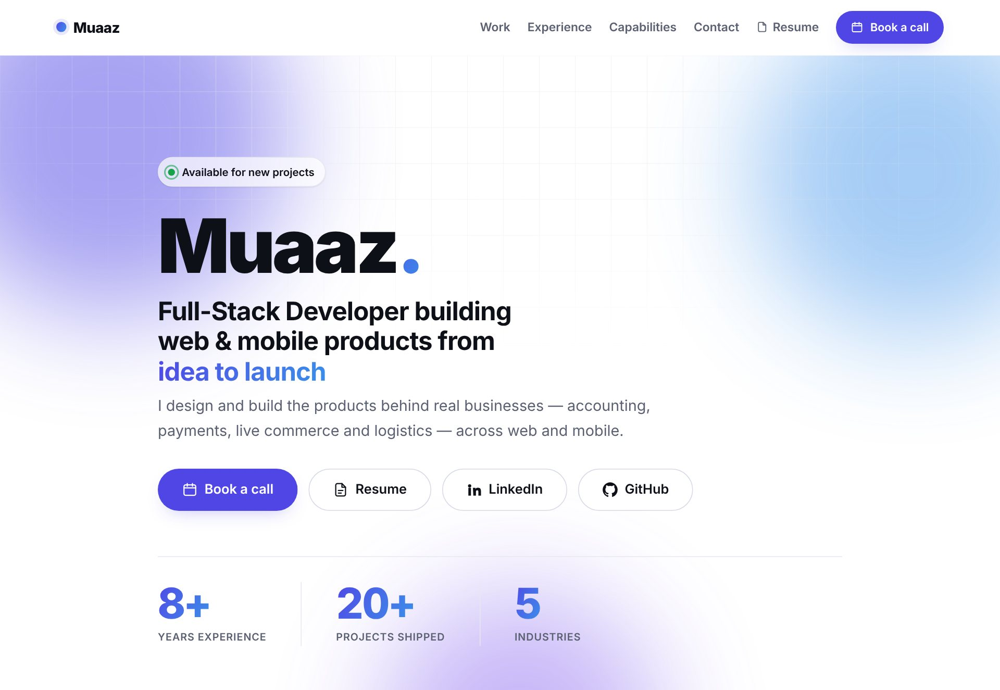

# Muaaz Hamood

**Senior Software Engineer · Full stack & AI-enabled**

I'm a senior software engineer with 8+ years of experience building full-stack web, mobile and SaaS products, from the database and API to the interface people actually use. I work mostly with C# / .NET, Angular, React and Node.js on Azure and AWS, and lately I've been shipping AI features: an agentic tool-calling assistant on Azure OpenAI and a RAG support chatbot. I work remotely with teams in the US, Denmark and the UK, and I've shipped 20+ projects across web and mobile.

## Selected work

Each project has a case study with flow screenshots on the [live site](https://muaaz852.github.io/portfolio/#work).

| Project | What it is | Built with | Code |
|---|---|---|---|
| [**Renuw**](https://muaaz852.github.io/portfolio/renuw.html) | Dual-portal renewable-energy platform: corporates trace their green power to its source assets, utilities allocate Guarantees of Origin | React, TypeScript, Mapbox GL, Recharts, TanStack Query | [Frontend](https://github.com/Muaaz852/renuw-corporate-frontend) · [Backend](https://github.com/Muaaz852/renuw-backend) |
| [**BarqBooks**](https://muaaz852.github.io/portfolio/barqbooks.html) | Accounting platform that brings invoices, bills, customers, vendors and bookkeeping into one dashboard | Next.js, NestJS, PostgreSQL, TypeScript | [Frontend](https://github.com/Muaaz852/barqbooks-frontend) · [Backend](https://github.com/Muaaz852/barqbooks-backend) |
| [**Impactify World**](https://muaaz852.github.io/portfolio/impactify-world.html) | Crypto-donation platform that lets NGOs accept Bitcoin and Ethereum through an embeddable, compliance-ready checkout widget | Vue.js, Quasar, NestJS, MySQL, Prisma, Coinify API | Private |
| [**ShoowMe**](https://muaaz852.github.io/portfolio/shoowme.html) | Live-commerce marketplace where sellers sell on camera and buyers chat and check out without leaving the stream | React, Express.js, Socket.IO, ZegoCloud | [Frontend](https://github.com/Muaaz852/shoowme) · [Backend](https://github.com/Muaaz852/shoowme-backend) |
| [**Taxi Management**](https://muaaz852.github.io/portfolio/taxi-management.html) | Offline-first fleet system: a driver app for shifts, rides and payments, plus an admin panel for real-time oversight | React Native, Expo, WatermelonDB, NestJS, MongoDB | [Mobile](https://github.com/Muaaz852/taxi-management-mobile) · [Frontend](https://github.com/Muaaz852/taxi-management-frontend) · [Backend](https://github.com/Muaaz852/taxi-management-backend) |

## Experience

**Senior Software Engineer** · MX Data, retail order-management SaaS (New York, remote) · *Feb 2025 – Sep 2026*\
Built an agentic LLM assistant on Azure OpenAI that answers warehouse and customer-service questions about live orders. Led the AngularJS → Angular 21 rewrite of the fulfillment app (11 feature modules, 550 automated tests), cut Shopify API calls per order cycle by 70% with GraphQL batching, and moved CI/CD to Azure DevOps.

**Full Stack Developer** · The Language Doctors, translation services (Maryland, remote) · *Dec 2022 – Jan 2025*\
Led a three-developer rebuild of the company-wide workflow app from ASP.NET MVC and jQuery to ASP.NET Core and Angular. Built real-time chat with SignalR, WebRTC audio and video calling, and PII redaction for the translation workflow.

**Full-Stack Software Engineer (Freelance)** · Remote · *Sep 2018 – Jan 2025*\
Built the products above, plus real-time platforms for freight and load management and UK workplace-safety wearables. Deployed client apps on AWS with Docker and CI/CD.

**Full-Stack Developer** · HISDU, Government of Punjab · *Jan 2020 – Jan 2022*\
Delivered four province-level public-health systems (medicine inventory, polio monitoring, TB control and COVID vaccination) on ASP.NET Core, Angular and SQL Server.

## Tech stack

- **Backend:** C#, .NET 8, ASP.NET Core, Entity Framework Core, Node.js, NestJS, Express.js, GraphQL, RabbitMQ, SignalR, Socket.IO
- **Frontend:** Angular, React, Next.js, Vue.js, TypeScript, Tailwind CSS, PrimeNG, Angular Material
- **Mobile:** React Native, Expo, Flutter, offline-first sync
- **AI & LLM:** Azure OpenAI / AI Foundry, OpenAI, Claude and Gemini APIs, agentic tool calling, RAG, Qdrant, pgvector
- **Cloud & DevOps:** Azure, AWS, Docker, Nginx, IIS, Azure DevOps, GitHub Actions, GitLab CI, Jenkins
- **Data:** SQL Server, PostgreSQL, MySQL / MariaDB, MongoDB, Redis, Prisma, TypeORM

## Get in touch

I'm available for new projects. [Book a call](https://calendly.com/muaaz-hamood-barqbytes), connect on [LinkedIn](https://www.linkedin.com/in/muaaz-hamood/), or see the full details in my [resume](https://muaaz852.github.io/portfolio/assets/Muaaz-Hamood-Resume.pdf).

---

This repository holds the source of [muaaz852.github.io/portfolio](https://muaaz852.github.io/portfolio/). © 2026 Muaaz Hamood. All rights reserved.
